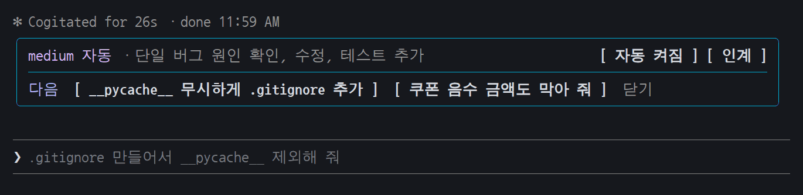
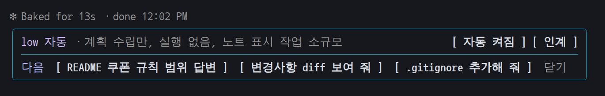
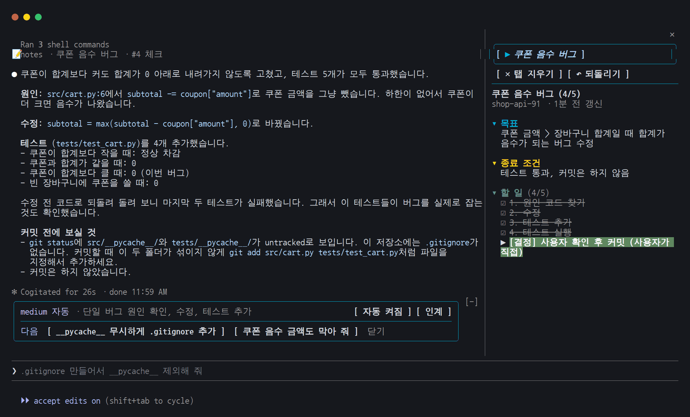

# pilot — 입력창 위 막대 하나로 effort·다음 할 일·인계를 챙기는 Claude Code 모드

질문마다 **생각하는 강도(effort)를 알아서 고르고**, 답이 끝나면 **다음에 할 만한 일을 제안하고**, 대화가 길어지면 **새 대화로 넘기라고 알려 줍니다.** 전부 입력창 바로 위 막대 하나에, 한국어로.



<sub>실제 Claude Code 터미널 화면입니다(예제 프로젝트).</sub>

## 왜 쓰나

- **effort 를 매번 손으로 바꾸지 않아도 됩니다.** 질문을 보낼 때 Haiku 가 먼저 읽고 그 요청 하나의 effort 만 고릅니다. 짧은 조회는 `low`, 여러 파일을 고치는 일은 `high`. 왜 그렇게 골랐는지도 막대에 한 줄로 보입니다.
- **다음 질문을 치는 수고가 줄어듭니다.** 답이 끝나면 이어서 할 만한 일을 3개까지 띄웁니다. 누르면 입력창에 초안으로만 들어가고, 보내는 건 사용자가 합니다. 1번은 입력창에 흐리게 보여서 Tab 으로 채웁니다.
- **긴 대화를 깔끔하게 끊습니다.** [인계] 를 누르면 인계 메모를 써서 새 대화로 넘깁니다. 대화가 30% 넘게 차고 넘기는 게 낫다고 판단되면 버튼이 밝아집니다.
- **한도를 아낍니다.** 5시간·주간 한도가 80% 를 넘으면 알려 주고, [절약 켜기] 를 누르면 한도가 풀릴 때까지 자동 effort 를 medium 이하로 묶습니다.



대화 화면 전체에서는 이렇게 보입니다(오른쪽 창은 함께 쓰기 좋은 [notes](../notes)).



## 설치

```
claude plugin marketplace add somegee/somegee-skills
claude plugin install pilot@somegee-skills --scope user
```

이미 켜져 있는 세션에서는 `/reload-plugins`.

설치 뒤 겹치는 것을 끕니다: `effortless`, `next-steps` 플러그인. 상태줄(statusLine)은 그대로 두되 effort 표시는 빼는 것을 권합니다.
자동 effort 는 Opus 5.5·Sonnet 5.5 에서 돕니다. effort 를 바꾸면 캐시가 깨지는 모델에서는 쉽니다.

## 기능 전체

| 기능 | 내용 |
|---|---|
| effort 줄 | 맨 윗줄에 **실제로 보낸 effort** 와 그 근거를 이어서 보입니다(`low 자동 · 근거: 짧은 조회`). 폴더·모델·컨텍스트는 Claude Code 상태줄(statusLine)에 맡깁니다 — 상태줄에서는 effort 를 빼 두면 겹치지 않습니다 |
| 질문마다 effort 자동 | 질문을 보낼 때 Haiku 5.5 가 읽고 effort 를 고릅니다. 앱의 effort 설정은 그대로 두고 그 요청 하나만 바꿉니다. `/effort` 로 직접 바꾸면 그 세션은 자동이 꺼집니다. Opus 5.5·Sonnet 5.5 에서만 돌고, effort 를 바꾸면 캐시가 깨지는 모델(Fable 5.1 등)에선 쉽니다 |
| 하위 에이전트 effort | Agent 로 띄운 하위 에이전트도 맡은 일을 읽고 고릅니다(최소 medium) |
| 캐시·한도 | (캐시 알림을 켜면) 프롬프트 캐시(대화 앞부분을 잠시 보관해 싸고 빠르게 다시 읽는 것)가 만료되면 알려 주고, 한도가 80% 를 넘으면 [절약 켜기] 로 한도가 풀릴 때까지 effort 를 medium 이하로 묶습니다 |
| 다음 할 일 | 답이 끝나면 다음에 할 만한 질문을 3개까지 띄웁니다. **클릭하면** 입력창에 초안으로만 넣고 보내지 않습니다(숫자 키 단축키 없음). 1번은 입력창에 흐리게도 보여서 Tab 을 누르면 채워집니다. 말투는 내가 이 대화에서 쓴 말투(반말·존댓말)를 따라갑니다. 목록은 보낼 때까지 남아서, 다른 것을 누르면 초안이 바뀌고 같은 것을 다시 누르면 빠집니다. 입력창에 직접 쓴 글은 덮어쓰지 않습니다 |
| 인계 | 긴 대화를 끊고 인계 메모를 써서 새 대화로 넘깁니다. 빠르게(메모 모델은 설정에서: 대화 모델 fork / Haiku / Sonnet / Opus) / 꼼꼼히(git 확인 + `HANDOFF.md` 새로 씀, 대화 모델). 대화가 30% 넘게 차면 Haiku 가 '넘기는 게 낫다'고 볼 때 [인계] 가 밝아집니다 |
| 압축 모델 | (기본 원래대로) `/compact` 와 자동 압축 요약을 Haiku / Sonnet / Opus 중 고른 모델이 씁니다 |

사람이 보지 않는 세션(`claude -p`, 크론, SDK)에서는 아무것도 하지 않습니다.

## 명령어

| 명령 | 하는 일 |
|---|---|
| `/pilot 인계` · `/pilot 인계 꼼꼼` | 빠른 / 꼼꼼한 인계 |
| `/pilot 자동` | 질문별 자동 effort 켜기·끄기 |
| `/pilot 절약` | 절약 모드 켜기·끄기 |
| `/pilot 상태` | 마지막 요청에 앱 설정과 실제로 보낸 effort, 판정 횟수 |

## 설정 (`/config` → pilot 항목에서만 바꿈)

| 설정 | 기본 |
|---|---|
| 질문마다 effort 자동 | 켬 |
| 자동 effort 최저 (low / medium / high / xhigh / max) | low |
| 자동 effort 최고 (low / medium / high / xhigh / max, 최저보다 낮으면 맞바꿈) | high |
| 하위 에이전트도 자동 | 켬 |
| 다음 할 일 제안 | 켬 |
| 인계 추천 알림 | 켬 |
| 인계한 다음 (정리 후 대기 / 정리 후 계속 / 복사만) | 정리 후 대기 |
| 인계 메모 모델 (대화 모델 / Haiku / Sonnet / Opus) | 대화 모델 |
| 한도 경고와 절약 모드 | 켬 |
| 압축 모델 (원래대로 / Haiku / Sonnet / Opus) | 원래대로 |
| 캐시 만료 알림 | 끔 |
| [자동]·[인계] 버튼 | 켬 (끄면 effort·근거만 보이고 버튼은 알림 있을 때만, 인계·자동은 `/pilot` 명령으로) |

권한 확인 생략 모드에서 '정리 후 계속'을 고르면 새 대화가 묻지 않고 바로 이어서 일합니다.

## 비용

판정·인계 추천은 Haiku 5.5 를 쓰는 사람의 Claude 로그인으로 부릅니다(키 필요 없음). 다음 할 일과 '대화 모델' 인계는 세션을 fork 해서 프롬프트 캐시를 같이 쓰므로 짧은 답 한 번 값입니다. 인계·압축 모델을 따로 고르면 그 모델이 대화 전체를 새로 읽습니다.

## English

pilot is a Claude Code mod that puts one band above the prompt box:

- **Auto effort per question** — Haiku reads each prompt and picks the effort for that single request (your app setting is untouched), and the band shows why.
- **Next steps** — after each answer, up to three follow-up prompts. Clicking one only drafts it in the prompt box; you still press Enter.
- **Handoff** — when a conversation gets long, write a handoff memo and continue in a fresh conversation.
- **Limit guard** — warns at 80% of the 5-hour / weekly limit and can cap auto effort until it resets.

Install: `claude plugin marketplace add somegee/somegee-skills` then `claude plugin install pilot@somegee-skills --scope user`. The band's wording is Korean.

## 개발

```
claude plugin validate pilot
claude plugin test pilot
claude --plugin-dir pilot      # 고친 뒤 /reload-plugins
```

effortless(HeyCubit)와 next-steps(Thariq Shihipar)의 일부를 한국어로 옮겼습니다. 저작권 고지는 [NOTICE](./NOTICE).
